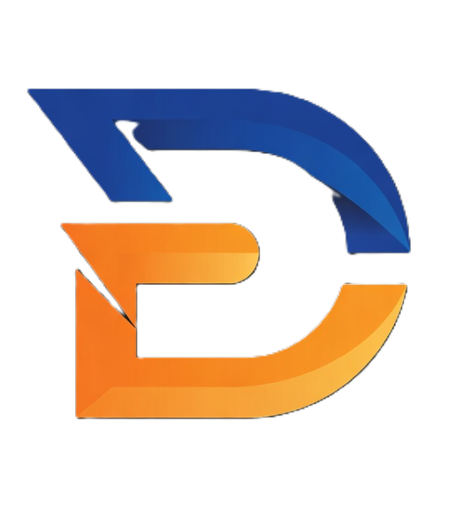
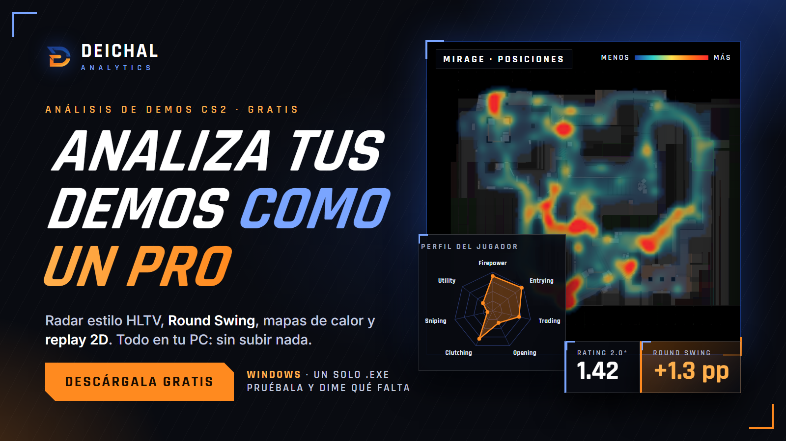

<div align="center">



# DEICHAL ANALYTICS

**Analizador de demos de CS2 para analistas, 100 % local y gratuito.**
Importa tus demos y obtén perfiles de jugador, vista de equipo, resúmenes de partida y un reproductor 2D, sin subir nada a ningún servidor.

[⬇️ Descargar el .exe](../../releases/latest) · [☕ Apoyar en Ko-fi](https://ko-fi.com/deichalcs2) · [𝕏](https://x.com/_deichal_) · [Instagram](https://instagram.com/deichalcs) · [Twitch](https://twitch.tv/deichal) · [TikTok](https://www.tiktok.com/@_deichal_)



</div>

---

## ✨ Qué hace

| Pestaña | Contenido |
|---|---|
| **Jugadores** | Gráfico de araña estilo HLTV (Firepower, Entrying, Trading, Opening, Clutching, Sniping, Utility), +30 KPIs (Rating 2.0\*, KAST, ADR, **Round Swing**, % de clutch guardado…), score de potencia por mapa, impacto según el momento de la ronda, swing ronda a ronda, rendimiento por economía, zonas donde juega/mata/muere, **mapa de calor** de posiciones, kills y muertes, y **mapa de utilidad**. Todo desagregable por mapa, bando (T/CT) y partida. |
| **Equipo** | Resumen estilo HLTV, medias transversales por rol, tabla de jugadores ordenable, win% por situación (pistol, eco, force, full, post-plant, retake), sitios de plant A/B, pool de mapas con pick/ban sugerido, economía (anti-eco, upsets), cómo se ganan y pierden las rondas, evolución por partida y utilidad/supervivencia. |
| **Partidas** | Resumen de cada demo: marcador por partes, MVP, scoreboard de los 10 jugadores, economía por ronda, línea de rondas (motivo, sitio, clic para verla), multikills y clutches. |
| **Reproductor** | Replay 2D ronda a ronda sobre el radar: jugadores con visión, vida, arma y dinero, kills, humos, molotovs, flashes y HEs, bomba, línea de tiempo y lista de eventos. |
| **Demos** | Importar (arrastrar y soltar), reprocesar y eliminar partidas. |

> \* Las métricas son **aproximaciones** de las de HLTV calculadas a partir de los datos de la demo. No son valores oficiales. La fórmula de cada una está en el botón *Metodología* de la propia aplicación.

## 🚀 Uso rápido (Windows)

1. Descarga **`DeichalAnalytics.exe`** desde la [última release](../../releases/latest).
2. Colócalo en una carpeta vacía (junto a él se crearán `data/` y `demos/`) y haz doble clic.
3. Se abre el navegador en `http://localhost:8000`. En la pestaña **Demos** arrastra tus `.dem` o `.dem.zst` (cada demo tarda ~20 s en procesarse).
4. Explora. Para cerrar la aplicación, cierra la ventana negra.

> ⚠️ **Windows SmartScreen** puede mostrar «Windows protegió su PC» porque el ejecutable no está firmado. Pulsa **Más información → Ejecutar de todas formas**. Si prefieres no fiarte de un binario, puedes ejecutarlo desde el código fuente (ver abajo).

La primera vez que se abre puede tardar unos segundos mientras se descomprime.

### Radares de los mapas

Se incluyen los radares de **Mirage, Inferno, Ancient, Dust2, Nuke, Overpass, Anubis, Vertigo y Train** (1024×1024, ya calibrados). Para otro mapa, copia su radar `de_<mapa>.png` en una carpeta **`maps/`** junto al `.exe` (o en `app/static/maps/` si ejecutas desde el código); sin radar, el mapa se dibuja con una silueta generada a partir de las posiciones de los jugadores. En Nuke y Vertigo (varios pisos) solo se muestra el piso superior.

## 🧩 Datos que necesitas

Demos de CS2 (`.dem`) o comprimidas con zstd (`.dem.zst`, como las que descargas de FACEIT). Se han probado demos de 64 ticks de FACEIT. Todo se procesa en tu equipo y **nada sale de él** (la web solo carga las tipografías de Google Fonts si hay conexión; sin ella usa las del sistema).

## 🛠️ Ejecutar desde el código

```bash
git clone <este repositorio>
cd Deichal_analytics
pip install -r requirements.txt
python main.py            # abre http://localhost:8000
```

También por línea de comandos, para procesar una carpeta de demos: `python -m parser.demo_parser demos/raw` (añade `--force` para reprocesar).

### Compilar el .exe

```bash
pip install -r requirements-build.txt
python build.py           # genera dist/DeichalAnalytics.exe
```

## 🗂️ Estructura

```
main.py                 punto de entrada (arranca el servidor y abre el navegador)
build.py                compilación con PyInstaller
app/
  server.py             API FastAPI + cola de procesado
  analytics.py          métricas, radar, swing, equipos, mapas de calor, resumen de partida
  paths.py              rutas y versión (funciona dentro y fuera del .exe)
  static/               interfaz web (HTML/CSS/JS sin dependencias de build)
parser/demo_parser.py   demo -> tablas parquet (rondas, jugador-ronda, kills, posiciones, granadas)
data/                   (se crea) partidas procesadas y roles
demos/raw/              (se crea) tus demos
maps/                   (opcional) radares 1024x1024
```

## ⚙️ Notas técnicas

- El parseo usa [demoparser2](https://github.com/LaihoE/demoparser). Con la versión actual, la lectura de **eventos** (`player_death`, `round_end`) falla en las demos de FACEIT, así que kills, trades, clutches y rondas se **reconstruyen desde los datos por tick** y se verifican contra los totales del propio juego (kills, muertes, asistencias y daño).
- El *Round Swing* usa un modelo heurístico de probabilidad de ganar la ronda (jugadores vivos y bomba), no el de HLTV, que no es público. Sirve para comparar jugadores entre sí dentro de tus demos.
- Los clanes que comparten 3 o más jugadores se unifican en un solo equipo (útil con suplentes o cambios de nombre).
- El sitio de plant y la posición de la bomba se **deducen** de dónde estaban los T al plantar.
- Pick/ban y otras recomendaciones son orientativas y poco fiables con pocas rondas por mapa.

## ☕ Apoya el proyecto

Esta herramienta es gratuita. Si te sirve, puedes invitarme a un café en **[Ko-fi](https://ko-fi.com/deichalcs2)** o seguirme:
[𝕏 @_deichal_](https://x.com/_deichal_) · [Instagram @deichalcs](https://instagram.com/deichalcs) · [Twitch deichal](https://twitch.tv/deichal) · [TikTok @_deichal_](https://www.tiktok.com/@_deichal_)

## 🙏 Créditos y avisos

- Parser: [demoparser2](https://github.com/LaihoE/demoparser) por LaihoE.
- Tipografías: [Rajdhani](https://fonts.google.com/specimen/Rajdhani) e [Inter](https://rsms.me/inter/) (SIL Open Font License).
- Radares de los mapas: [MurkyYT/cs2-map-icons](https://github.com/MurkyYT/cs2-map-icons), extraídos de los archivos del juego.
- Proyecto independiente, **sin relación con Valve, HLTV ni FACEIT**. *Counter-Strike*, los mapas y sus radares son marcas y propiedad de Valve Corporation. Las métricas se inspiran en las públicas de HLTV. Los logos de Ko-fi, X, Instagram, Twitch y TikTok pertenecen a sus respectivos titulares.

## 📄 Licencia

Código bajo **[GNU AGPL-3.0](LICENSE)** © 2026 Deichal. Puedes usarlo, estudiarlo, modificarlo y redistribuirlo; si distribuyes una versión modificada (o la ofreces como servicio en red) debes publicar su código fuente bajo la misma licencia. La licencia cubre el código de este repositorio, **no** los radares ni los logos de terceros indicados arriba.
